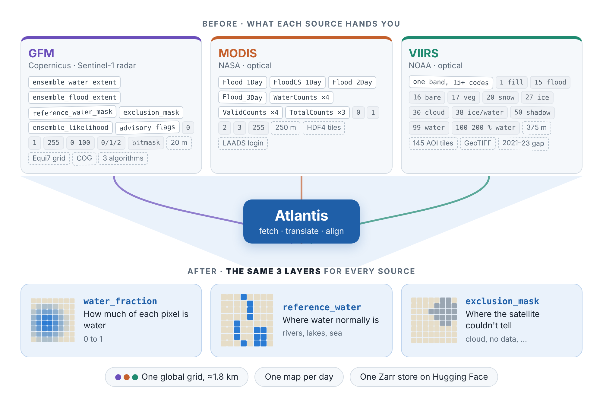
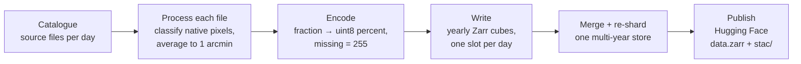
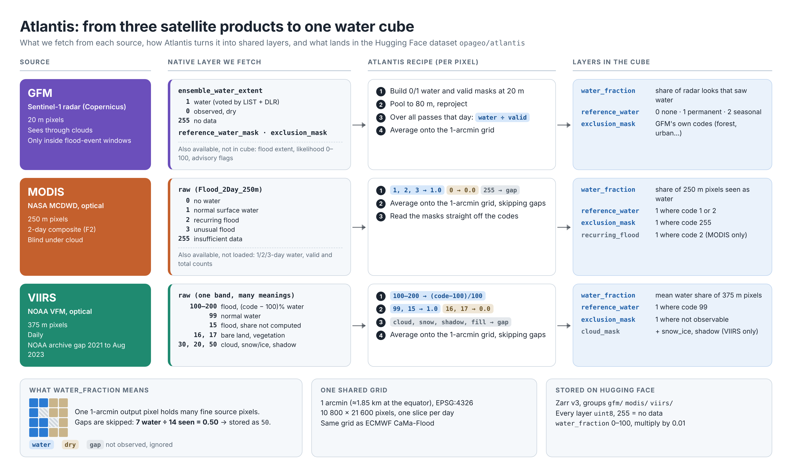

# How Atlantis works

This page is the starting point if you are new to Atlantis. It explains what
the data means before you run anything. The first half is the high-level
picture. The second half goes source by source and shows exactly how each
native pixel becomes an Atlantis value.

If you just want to install and run something, go to
[Pixi setup](pixi-setup.md) and come back here when the output needs
explaining.

## In one picture

Three satellite products map surface water. Each has its own layers, value
codes, pixel size, tiling and file format. Atlantis fetches them, translates
their codes into the same few layers, and puts everything on one global grid,
one map per day.

## The big ideas

### Two ways a satellite sees water

| | Optical (MODIS, VIIRS) | Radar / SAR (GFM on Sentinel-1) |
| --- | --- | --- |
| How it works | Measures reflected sunlight. Water absorbs infrared, so it looks dark. | Sends its own microwave pulse. Calm water mirrors it away, so it looks dark. |
| Strengths | Daily, global, long archives | Sees through clouds and at night; 20 m detail |
| Weaknesses | Blind under clouds; shadows can look like water; 250–375 m pixels | A pass only every few days; struggles in cities, forests and mountains |

The sources are strong exactly where the others are weak. That is the reason
to use them together.

### Water is not the same as flood

Satellites see **water**. A **flood** is water where there normally isn't
any. Atlantis therefore stores both:

- `water_fraction`: all water seen that day, including rivers, lakes and sea.
- `reference_water`: where water normally is.

Flood is roughly water minus reference water. Keeping both lets you choose
what "normal" means for your use case.

### The three core layers

Every source produces the same three core layers:

| Layer | Question it answers | Values |
| --- | --- | --- |
| `water_fraction` | How much of this pixel is water today? | 0 to 1 (stored as 0–100) |
| `reference_water` | Is this normally water? | 0/1 for MODIS and VIIRS; 0/1/2 (none, permanent, seasonal) for GFM |
| `exclusion_mask` | Should I ignore this pixel? | 0/1 for MODIS and VIIRS; GFM's own codes for GFM |

Some sources add extras: MODIS has `recurring_flood`, and VIIRS has
`cloud_mask`, `snow_ice` and `shadow`. The full list is in
[Layers](layers.md).

### One shared grid

All outputs are on the same global grid:

- 1 arcminute pixels (1/60°, about 1.85 km at the equator), EPSG:4326
- 10 800 × 21 600 pixels covering the whole globe
- the same grid as ECMWF's CaMa-Flood (`Globe_flood_area`)
- one slice per day

The same pixel index is the same patch of ground in every source.

### What `water_fraction` means

One Atlantis pixel holds many native pixels: about 64 MODIS pixels, about 25
VIIRS pixels, or about 530 GFM pixels (after GFM is pooled to 80 m). Atlantis
turns each native pixel into a water value between 0 and 1, marks the ones
that could not be observed (cloud, no data), and averages the rest.

For example, if 14 native pixels inside one output pixel were observed and 7
of them are water, `water_fraction` is 7 / 14 = 0.50. The unobserved pixels
are ignored, not counted as dry. If nothing was observed, the value is
missing.

`water_fraction` is computed per output pixel, never per tile or per file.

### How the archive is built

The published dataset is
[opageo/atlantis on Hugging Face](https://huggingface.co/datasets/opageo/atlantis):
one Zarr v3 store with a group per source (`gfm/`, `modis/`, `viirs/`) and a
STAC catalogue. See [Inside the cube](#inside-the-cube) below for the layout.

## Source by source

This diagram summarises the rest of the page: what is fetched from each
source, the recipe applied per pixel, and what ends up in the cube.

*Click the image to open it full size.*

| | MODIS | VIIRS | GFM |
| --- | --- | --- | --- |
| Provider | NASA (LANCE / LAADS DAAC) | NOAA JPSS (public AWS bucket `noaa-jpss`) | Copernicus EMS, via the EODC STAC API |
| Sensor | Optical, Terra + Aqua | Optical, Suomi-NPP + NOAA-20 | C-band radar, Sentinel-1 |
| Native pixel | ~250 m, 10° × 10° tiles | 375 m, 15° × 15° tiles | 20 m, Equi7 tiles |
| Revisit | Daily (we use a 2-day composite) | Daily | Every few days |
| Format | HDF4 | GeoTIFF, one band of codes | Cloud-optimised GeoTIFFs |
| Access | Free Earthdata token | Anonymous | Public |

### MODIS: NASA's Global Flood Product (MCDWD)

**How it is measured.** For every Terra and Aqua pass, NASA applies a
reflectance test: a pixel is water if it is dark in short-wave infrared,
not too bright in red, and darker in near-infrared than in red (vegetation is
the opposite). Clouds and their shadows move
between passes while floods stay, so the 2-day composite only keeps water seen
at least twice in two days. Pixels more than 30 m above the nearest stream
(HAND) are masked as insufficient data. Water is then labelled against a
reference: normal surface water, recurring (seasonal) flood, or unusual flood.

**What we fetch.** One layer from the HDF4 file, `Flood_2Day_250m` (the "F2"
composite, NASA's recommended default):

| Code | Meaning |
| --- | --- |
| `0` | No water |
| `1` | Surface (reference) water |
| `2` | Recurring flood |
| `3` | Unusual flood |
| `255` | Insufficient data (cloud, shadow, high ground) |

**What Atlantis does.**

1. Codes `1`, `2`, `3` → 1.0; `0` → 0.0; `255` → missing.
2. Average onto the 1-arcmin grid, skipping missing pixels.
3. Masks come straight from the codes: `reference_water` where `1` or `2`,
   `recurring_flood` where `2`, `exclusion_mask` where `255`. Masks take the
   most common value inside the output pixel.

**Where it goes wrong.** Clouds hide the ground and their shadows can look
like water. 250 m pixels miss narrow rivers and floods that drain within a
day. Water under tree canopy or between buildings is invisible. Dark surfaces
such as burn scars or lava can pass the water test. New reservoirs can show up
as flood until the reference catches up.

**Also available, not used.** The 1-day (F1), cloud-shadow screened 1-day
(F1C) and 3-day (F3) composites are selectable with `--modis-composite`. The
file also has 11 count layers (potential, clear-sky and water observations per
window) that the default pipeline does not load.

More detail: [MODIS overview](modis/overview.md).

### VIIRS: NOAA's Flood Mapping product (VFM)

**How it is measured.** NOAA classifies each pixel as cloud, snow/ice, clear
land or water using visible, near-infrared, short-wave infrared and thermal
bands, with a decision tree trained on about 600 000 samples. Cloud and
terrain shadows are removed. For flood pixels, NOAA then estimates how much of
the pixel is water by linear mixing: water is dark in short-wave infrared, so
a pixel's reflectance, placed between nearby pure-land and pure-water pixels,
gives its water share. The daily product keeps the maximum over the day's
passes.

**What we fetch.** A single GeoTIFF band where each code means something
different:

| Code | Meaning |
| --- | --- |
| `0`, `1` | No data / fill |
| `16` | Bare land |
| `17` | Vegetation |
| `20` | Snow / ice |
| `27`, `38` | River or lake ice; mixed ice and water |
| `30` | Cloud |
| `50` | Cloud or terrain shadow |
| `99` | Normal water (reference) |
| `15` | Flood, fraction not computed |
| `100`–`200` | Flood, water share = (code − 100)% |

**What Atlantis does.**

1. `100`–`200` → (code − 100) / 100.
2. `99` and `15` → 1.0. Bare land and vegetation (`16`, `17`) → 0.0.
3. Fill, cloud, snow/ice and shadow → missing (and `exclusion_mask = 1`).
4. Average onto the 1-arcmin grid, skipping missing pixels.

`reference_water` is code `99`. VIIRS is the only source with separate
`cloud_mask`, `snow_ice` and `shadow` layers, which tell you why a pixel is
missing.

**Where it goes wrong.** Same cloud problem as MODIS, and shadow removal
depends on guessing cloud height. The fraction is designed for pixels that are
at least 25% water. Volcanic rock, burn scars and hazy cities can be called
water. Keeping the daily maximum can overstate flooding if one pass is wrong.

**Coverage gap.** NOAA's public bucket has no VFM data from 2021 to
9 August 2023.

**Also available, not used.** A 5-day maximum composite (`VFM_5day_GLB`) with
far fewer cloud gaps, and NetCDF and shapefile versions of the same maps.

More detail: [VIIRS overview](viirs/overview.md).

### GFM: Copernicus Global Flood Monitoring on Sentinel-1

**How it is measured.** Sentinel-1 measures radar backscatter at 20 m. Calm
water reflects the pulse away from the satellite and looks dark. Three
independent algorithms look for that signal:

- **LIST** (change detection): flags pixels that got much darker than in an
  earlier image of the same place.
- **DLR** (automatic threshold): finds the brightness cut-off that best
  separates the dark water peak from the bright land peak in each scene.
- **TU Wien** (pixel history): learns from years of data what each pixel
  normally looks like, wet or dry, and compares today's value to that.

Their majority vote gives the flood map, and their confidences give a 0–100
likelihood. The **water** map (`ensemble_water_extent`) uses LIST and DLR
only, because TU Wien only detects temporary flooding.

**What we fetch.**

| Band | Values | Meaning |
| --- | --- | --- |
| `ensemble_water_extent` | 0 / 1 / 255 | All open water seen in one Sentinel-1 pass. **Feeds `water_fraction`.** |
| `ensemble_flood_extent` | 0 / 1 / 255 | Flood only |
| `reference_water_mask` | 0 / 1 / 2 / 255 | None, permanent, seasonal (per calendar month), from a 2017–2021 baseline |
| `exclusion_mask` | native codes | Where radar flood mapping is unreliable (static) |
| `ensemble_likelihood` | 0–100 | Confidence: 0 = surely dry, 50 = threshold, 100 = surely flooded |
| `advisory_flags` | bitmask | 1 = low backscatter region (snow, frozen or dry soil), 2 = rough water (wind, rain) |

**What Atlantis does.**

1. Build 0/1 water and "valid" (observed) masks at 20 m.
2. Mean-pool by 4 to 80 m. Each 80 m pixel is then a fraction. This step
   mainly cuts processing cost (16× fewer pixels to reproject); since the
   final value is an average, it barely changes the result.
3. Reproject, and across all passes on the same date compute
   water count ÷ valid count.
4. Average onto the 1-arcmin grid.

`reference_water` keeps GFM's three classes. `exclusion_mask` keeps GFM's own
codes. It is **not** a 0/1 mask like MODIS and VIIRS.

**The exclusion mask.** GFM excludes places where radar cannot map floods
reliably: dense forest and built-up areas (radar can't see water under canopy
or between buildings), places that are dark most of the time anyway (sand,
dry soil, tarmac), ground 10 m or more above the nearest drainage, radar
shadow behind steep slopes, and areas with too few Sentinel-1 observations.

**Where it goes wrong.** Wind-roughened water looks bright like land, which
is what the advisory flag warns about. Flooded vegetation and flooded streets
can go undetected.

**Only around labelled events.** GFM in the Atlantis dataset is not global and
daily. It was processed inside the date windows and areas of two benchmark
collections, [GEOID-Flood and KuroSiwo](archive/events-gfm.md).

**Also available, not stored.** `ensemble_likelihood` and `advisory_flags` are
fetched but not written to the cube. Each algorithm's own flood map is also
published by GFM; disagreement between them is a natural uncertainty signal.

More detail: [GFM overview](gfm/overview.md).

## Inside the cube

Each source group has dimensions `(time, y, x)`, one slot per day.

| Variable | MODIS | VIIRS | GFM | How to read it |
| --- | --- | --- | --- | --- |
| `water_fraction` | ✓ | ✓ (sub-pixel) | ✓ (from counts) | Stored 0–100; decodes to 0–1. Includes normal water. |
| `reference_water` | 0/1 | 0/1 | 0 / 1 permanent / 2 seasonal | Subtract from water to get flood. |
| `exclusion_mask` | 0/1 | 0/1 | native GFM codes | 1 = could not observe (MODIS/VIIRS). |
| `recurring_flood` | ✓ | – | – | MODIS seasonal flooding. |
| `cloud_mask`, `snow_ice`, `shadow` | – | ✓ | – | Why a VIIRS pixel is missing. |

**Storage.**

- Zarr v3, all variables `uint8`, fill value 255.
- `water_fraction` has `scale_factor = 0.01`.
- Read unit (inner chunk): 1 day × 256 × 256 pixels, a natural ML training
  patch.
- Pixel centres: lon = −180 + (i + 0.5) / 60, lat = 90 − (j + 0.5) / 60,
  rows north to south.

**Reading tip.** Opening the store with xarray's defaults turns every variable
into float with NaN for 255, including the masks. Use `mask_and_scale=False`
if you want the raw `uint8` class codes, and apply the 0.01 scale to
`water_fraction` yourself.

The full storage spec is in the [Zarr datacube spec](archive/zarr-spec.md).

## Before you combine sources

The layers share names, but not always meanings:

| Trap | What differs |
| --- | --- |
| `reference_water` | GFM: none / permanent / seasonal. MODIS, VIIRS: yes/no. |
| `0` in masks | GFM `0` = seen and dry. For MODIS and VIIRS, `0` can also mean "not seen"; check `exclusion_mask`. |
| `exclusion_mask` | MODIS, VIIRS: "couldn't see today". GFM: "radar is unreliable here". |
| "Water" | Three different estimators; expect systematic offsets between sources. |
| Time | MODIS = 2-day composite, VIIRS = 1 day, GFM = pass days inside event windows. |

[Layers: cross-source gotchas](layers.md#layers-cross-source) has the details.

## Where to go next

- [Pixi setup](pixi-setup.md): install and run the Valencia 2024 demo.
- [Credentials & setup](setup.md): Earthdata token and other accounts.
- [Layers](layers.md): every native and derived layer, generated from the code.
- [CLI reference](cli.md) and [end-to-end examples](https://github.com/opageo/atlantis/blob/main/CLI_Examples.md).
- Per-source deep dives: [MODIS](modis/overview.md),
  [VIIRS](viirs/overview.md), [GFM](gfm/overview.md).

### Sources for the measurement descriptions

- NASA MCDWD User Guide (MODIS/VIIRS NRT Global Flood Product).
- NOAA VIIRS Flood Mapping ATBD v1.0.
- Copernicus GFM Product Definition Document, and "Estimating Ensemble
  Likelihoods for the Sentinel-1-Based Global Flood Monitoring Product of the
  Copernicus Emergency Management Service", IEEE JSTARS, 2023.
